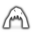
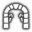
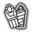
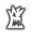
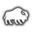
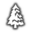
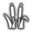
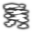

# Map Routes

By [garcipat](https://github.com/garcipat) · [Source code on GitHub](https://github.com/garcipat/valheim-quickfix)

Map Routes adds a few things to the large map that help you plan your trips:

- **Routes:** draw the way you want to go on the map with a quill. Routes are saved with your character, per world.
- **Pin icons:** name a circle pin `Cave`, `Portal` or `Swamp` and it shows a matching icon instead of the circle.
- **Pin what you look at:** look at a berry bush, copper or a cave entrance and press **F8**. A pin with its icon
  lands on the map.
- **Biome borders:** faint dashed lines where one biome meets another. They are off until you turn them on.
- **Round, bigger corner map:** put the small map in the corner on a round Viking shield, make it bigger, or both. Off until you turn it on.

Each one is explained in its own section below.

Client-side only: it works on any server and nothing needs to be installed on the server. Other players don't see
your routes.

## Drawing routes

- Open the large map (M) and click the **quill** above the pin icons. The mouse cursor turns into a quill.
- **Hold the left mouse button and drag** to draw. Letting go finishes the line; each line is its own route.
- **Hold the right mouse button and drag** to move the map while the quill is picked. The mouse wheel still zooms.
- **Right-click a route** (without dragging) to remove it. This works whether the quill is picked or not. A pin
  under the cursor comes first, so right-clicking a pin still removes the pin.
- **Click the quill again**, pick a pin icon or close the map to stop drawing. Left-drag moves the map again, as
  usual.
- While the quill is picked, clicking a pin doesn't cross it out and double-clicking doesn't add a pin.

Routes show on the large map and on the small map in the corner. You draw them on the large map. Sharing your map
through a cartography table doesn't pass them on.

## Pin icons

Place a **circle** pin as usual and give it one of the names below. The circle turns into the matching icon.

- The **whole name** has to match. Capital letters don't matter: `cave`, `Cave` and `CAVE` all work, but
  `Cave near home` stays a circle.
- With the **short name** (first column) you see only the icon, like the game's own pins.
- With a **longer name** (last column) you see the same icon with the name under it, so you still know which ore or
  which berries it is.
- Only circle pins change. Fire, house, hammer and rune pins stay as they are, whatever their name.

| Icon | Short name, icon only | Longer names, icon with name |
|---|---|---|
|  Cave | `Cave` | `Troll cave`, `Frost cave` |
|  Crypt | `Crypt` | `Sunken crypt` |
|  Dungeon | `Dungeon` | `Burial chamber` |
|  Mine | `Mine` | `Infested mine` |
|  Village | `Village` or `Camp` | `Fuling village`, `Fuling camp` |
|  Portal | `Portal` | |
|  Ship | `Ship` | `Boat`, `Karve`, `Longship` |
|  Ore | `Ore` | `Copper`, `Tin`, `Silver`, `Iron`, `Obsidian` |
|  Tar | `Tar` | `Tar pit` |
|  Berries | `Berries` | `Raspberries`, `Blueberries`, `Cloudberries` |
|  Mushroom | `Mushroom` | `Yellow mushroom`, `Blue mushroom`, `Jotun puffs`, `Magecap` |
|  Egg | `Egg` | `Dragon egg` |
|  Nest | `Nest` | `Greydwarf nest` |
|  Surtling | `Surtling` | `Fire geyser` |
|  Leviathan | `Leviathan` or `Turtle` | |
|  Lox | `Lox` | |
|  Forest | `Forest` | `Black forest` |
|  Swamp | `Swamp` | |
|  Mountain | `Mountain` | |
|  Plains | `Plains` | |
|  Mistlands | `Mistlands` or `Mist` | |
|  Ashlands | `Ashlands` or `Ash` | |
|  Deep North | `Deep North` or `North` | |

The pin itself doesn't change, only how it is drawn. Without the mod it is a circle with its name, so nothing is lost
if you remove it. Pins shared through a cartography table keep their name, so friends who have the mod see the
icons too.

## Pin what you look at

Look at something you want to find again and press **F8**. A pin with its icon is put on the map at that spot, and
you don't have to open the map. Things you can pin show an extra line, `[F8] Pin on map`, under their name.

| Look at | Pin |
|---|---|
| Troll cave or frost cave entrance | `Cave` |
| Burial chamber entrance | `Dungeon` |
| Sunken crypt entrance | `Crypt` |
| Infested mine entrance | `Mine` |
| Any other entrance you enter with E | `Dungeon` |
| Portal | the game's rune pin, named with the portal's tag |
| Any ship (at the rudder) | `Ship` |
| Raspberry, blueberry or cloudberry bush | `Berries` |
| Any mushroom | `Mushroom` |
| Tar at a tar pit | `Tar` |
| Dragon egg | `Egg` |
| Copper, tin or silver | `Ore` |

The pin gets the short name, so the map shows only the icon, like the game's own pins. To tell copper from silver,
rename the pin to `Copper` or `Silver`: it keeps the icon and shows the name under it.

- It is a normal pin (a circle, or the rune for a portal). You can rename, cross out or remove it like any other pin.
- If the same pin is already there (within about 10 m), you get "Already pinned" instead of a second pin.
- Inside caves and dungeons nothing is pinned, because the map can't show where you are in there.
- A ship's pin marks where the ship was when you pinned it. It doesn't follow the ship.
- It works with the game in any language.

## Configuration

- **General → BiomeBorders** (default off): faint dashed lines on the large map where one biome meets another, so
  you can see where the Black Forest ends and the Swamp begins. They only show on land and only where you have
  explored. Turn it on to see them.
- **General → PinHotkey** (default F8): the key that pins what you look at. Set it to `None` to turn it off.
- **General → VikingMap** (default off): makes the small map in the corner round and puts it on a painted Viking
  shield with a crossed axe and club behind it. The status effect icons next to the map move left to make room. Pins outside the circle are hidden, as the game hides them outside
  the square, and the biome name moves to the top middle.
- **General → MinimapScale** (default 1): the size of the small map in the corner, from 1 (the game's own size) to
  1.5 (half as big again). A bigger map shows more of the area around you; pins, your marker and the biome name keep their
  size. It grows evenly around its middle, and the status effect icons move left to make room.

Routes have no setting. To hide your routes, disable the mod in your mod manager. They come back when you enable it
again.

## Installation

Install through a mod manager such as Gale or r2modman. It installs
[BepInExPack Valheim](https://thunderstore.io/c/valheim/p/denikson/BepInExPack_Valheim/) automatically.

For a manual install, put `MapRoutes.dll` into `Valheim/BepInEx/plugins/`.

## Feedback

Bug reports, ideas, and source code: <https://github.com/garcipat/valheim-quickfix>

## License

MIT. See the `LICENSE` file in the package, or the source repository.

Pin icons by Lorc and Delapouite from [game-icons.net](https://game-icons.net), licensed under
[CC BY 3.0](https://creativecommons.org/licenses/by/3.0/). The Cave and Surtling icons are our own.
